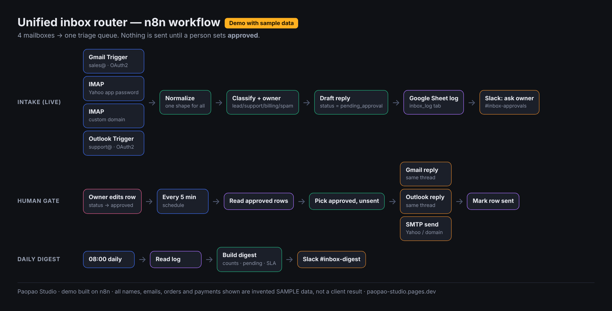
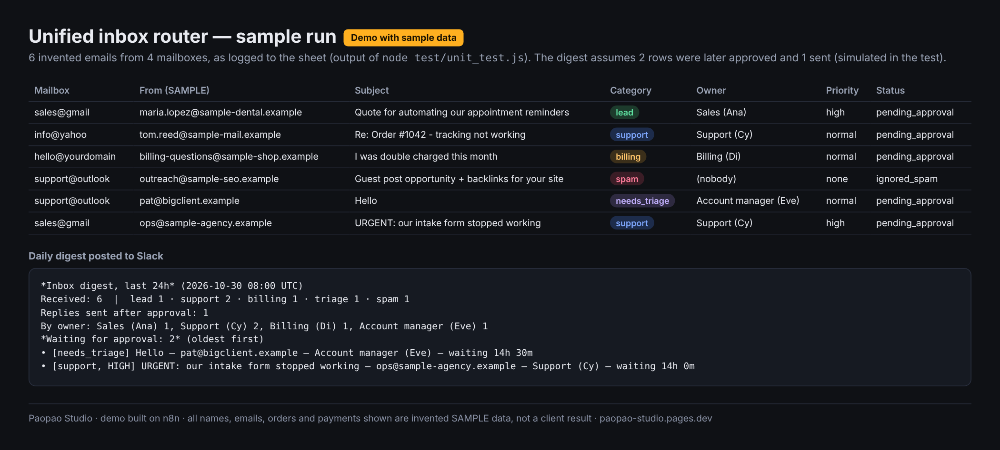

# Unified inbox router (n8n workflow)

Several inboxes (Gmail, Yahoo, a custom-domain mailbox, Outlook) land in **one triage queue**. Every new email is normalized, classified as **lead / support / billing / spam**, given an **owner**, and gets a **drafted reply that waits for a human**. Nothing is sent until a person marks the row `approved`. Everything is logged to a Google Sheet, and Slack gets a daily digest.

> **Demo with sample data.** The screenshots and test output below come from 6 invented emails (`*.example` domains). They are not a client result.



```
Gmail Trigger ───┐
IMAP (Yahoo) ────┤
IMAP (domain) ───┼─> Normalize ─> Classify & assign owner ─> Draft reply ─> Log to sheet ─> Needs approval? ─> Slack: ask owner
Outlook Trigger ─┘                                                         (status = pending_approval)

Every 5 min ─> Read approved rows ─> Pick approved, unsent ─> Switch by provider ─> Gmail reply | Outlook reply | SMTP send ─> Mark row sent
Daily 08:00 ─> Read log ─> Build daily digest ─> Slack #inbox-digest
```

Core n8n nodes only (no community nodes). Tested on n8n 2.45.6.

## Setup

1. n8n → **Workflows → Import from file** → `unified_inbox_router.workflow.json`.
2. Create a Google Sheet with a tab named `inbox_log` and this header row (row 1):
   ```
   msg_key	received_at	mailbox	provider	source_id	thread_id	from_email	from_name	reply_to	subject	snippet	category	confidence	matched_rules	owner	owner_email	priority	draft_reply	final_reply	status	approved_by	sent_at	logged_at
   ```
   Replace `YOUR_SHEET_ID` in the three Sheets nodes (or pick the sheet from the list).
3. Connect credentials (below) on each trigger and send node. Delete the triggers you do not need.
4. Edit the **Tag:** nodes (mailbox address + provider) and, in **Classify & assign owner**, the `OWNERS`, `DOMAIN_OWNERS` and `ALLOWLIST_DOMAINS` block. Edit `SIGNATURE` and `LINKS` in **Draft reply**.
5. Set the Slack channels (`#inbox-approvals`, `#inbox-digest`) and activate.

### Credentials

| Mailbox | n8n credential | Notes |
|---|---|---|
| Gmail / Google Workspace | Google OAuth2 (Gmail + Sheets) | See the re-auth limits below. |
| Yahoo Mail | IMAP + SMTP with an **app password** | Yahoo → Account security → Generate app password. Your normal password will not work. |
| Custom domain (cPanel, Zoho, Fastmail…) | IMAP + SMTP | Host/port from your mail provider. |
| Outlook.com / Microsoft 365 | Microsoft Outlook OAuth2 | Uses the Outlook Trigger, **not IMAP**: Microsoft switched off password (basic) auth for Outlook.com IMAP/SMTP, and n8n's IMAP node only supports passwords. |
| Google Sheets | Google Sheets OAuth2 | Same Google app as Gmail is fine. |
| Slack | Slack bot token | Bot must be invited to both channels. |

## How approval works

1. Each email is logged with `status = pending_approval` and a `draft_reply`. Spam is logged as `ignored_spam` with no draft. The owner gets a Slack ping with the draft.
2. A person opens the sheet, optionally writes their own text in `final_reply`, and sets `status` to `approved` (case does not matter).
3. Every 5 minutes the workflow picks rows that are `approved` and have an empty `sent_at`. It replies **from the same mailbox**: Gmail and Outlook reply in the original thread, Yahoo/custom-domain mail goes out over SMTP with `Re: <subject>`. `final_reply` is used if present, otherwise `draft_reply`.
4. The row is updated to `status = sent` with `sent_at`.

The workflow never sets `approved` itself, so it never auto-replies. If you later want auto-replies for one category, add an explicit rule; we recommend against it for leads and billing.

## Classifier

**Classify & assign owner** is a keyword/regex classifier. Every row records the rules that fired (`matched_rules`) and a `confidence`, so a decision can always be explained. Subject matches count double. Spam only wins when it scores at least 3 and beats every other category, so a real customer who mentions “unsubscribe” is not binned. Anything that matches nothing becomes `needs_triage`. Key-account domains always go to their named owner. Urgent words, or a lead that mentions a budget, set `priority = high`.

Limits: keywords miss sarcasm, other languages and unusual wording. To use an LLM, put n8n's **Text Classifier** (AI) node or an OpenAI/Anthropic chat node in its place and keep the same output fields (`category`, `confidence`, `owner`, `owner_email`, `priority`). Keep the human approval step either way.

## Known limits (read before promising a client anything)

- **Gmail re-auth.** If your Google Cloud OAuth app is left in *Testing*, refresh tokens expire after **7 days**. Publish the app to *In production*. Even then Google revokes tokens that go **unused for 6 months**, or when the user changes their password (Gmail scopes). The credential then needs to be reconnected.
- **Outlook needs OAuth.** Basic-auth IMAP/SMTP for Outlook.com is off, so use the Microsoft credential, not IMAP.
- **Discord: no personal DMs.** Discord bots cannot read a user's personal DMs, and automating a user account (self-bot) breaks Discord's terms. Server channels via a bot are fine.
- **WhatsApp: no personal-account API.** There is no official API for personal WhatsApp. Only the **WhatsApp Business Platform (Cloud API)** with a business number is supported. Unofficial bridges risk getting the number banned; this demo does not use them.
- **IMAP polling** sees new mail on its next poll, not instantly. Marking as read is up to your settings.
- The Google Sheet is a simple queue. For high volume, switch the log to n8n Data Tables or Postgres.

## Verified

- `node test/unit_test.js` runs the five Code nodes, taken straight from the workflow JSON, on `test/sample_emails.SAMPLE.json`. That file holds 6 invented emails in the real trigger shapes: Gmail, IMAP plain text, IMAP HTML-only and Outlook. The run checks that:
  - normalization works for all shapes;
  - classification is correct (lead, support, billing, spam, needs_triage, support);
  - key-account routing works;
  - urgent and budget priority are set;
  - spam gets no draft;
  - the approval gate holds: only `approved` + unsent rows are sent, `final_reply` overrides the draft, and already-sent rows are skipped;
  - the daily digest counts are right.

  It writes `test/sample_output.SAMPLE.json`.
- `test/validate_nodes.js` checks every node type and `typeVersion` against the installed `n8n-nodes-base` (2.45.5), plus the connections. `n8n import:workflow` on n8n 2.45.6 imports it cleanly.
- Not run end-to-end against live mailboxes: that needs real OAuth credentials.



*Demo with sample data. The digest in this screenshot is from the test run, which simulates two rows being approved and one sent.*

## Files

- `unified_inbox_router.workflow.json`: the importable workflow (generated by `build_workflow.py` from `src/*.js`)
- `src/`: Code node sources (normalize, classify & route, draft, pick approved, digest)
- `test/`: SAMPLE emails, unit test, SAMPLE output
- `docs/`: diagram and sample-output screenshots

## Want this on your own inboxes?

Paopao Studio sets this up on your real mailboxes, with your owners, wording and approval rules, and hands it over documented.
https://paopao-studio.pages.dev/?utm_source=github&utm_medium=readme&utm_campaign=demo_inbox_router

License: MIT
